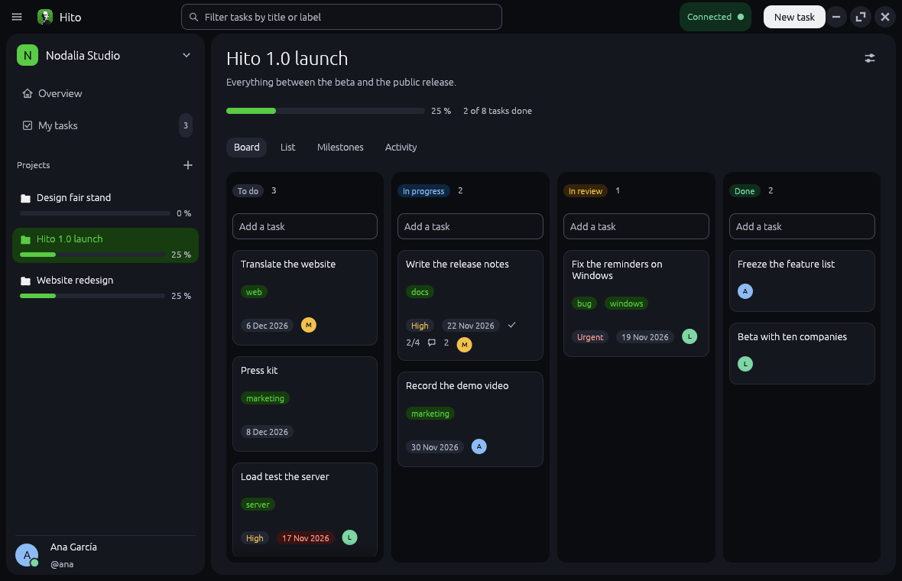
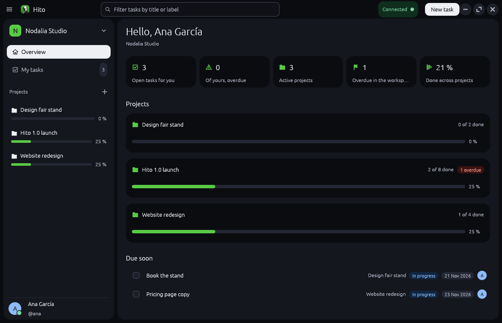
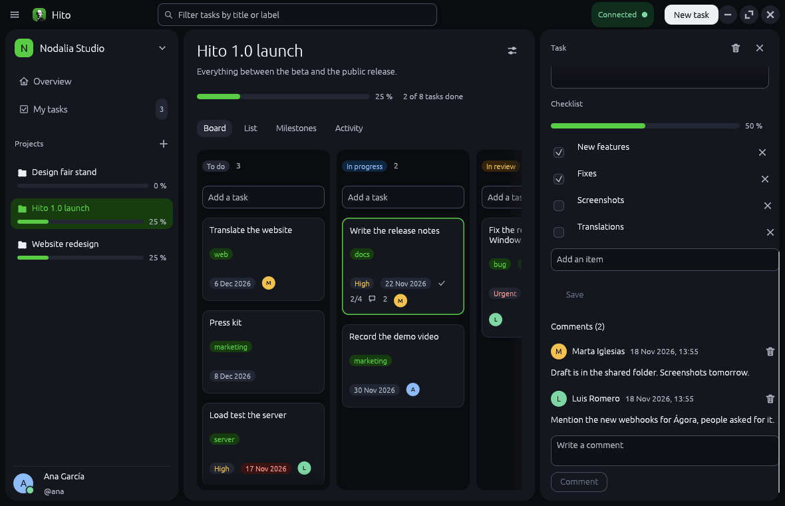
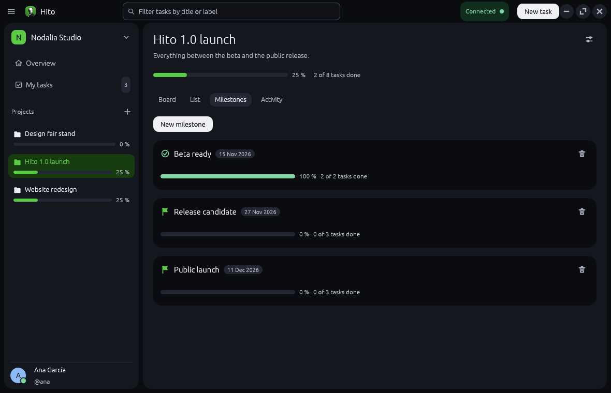
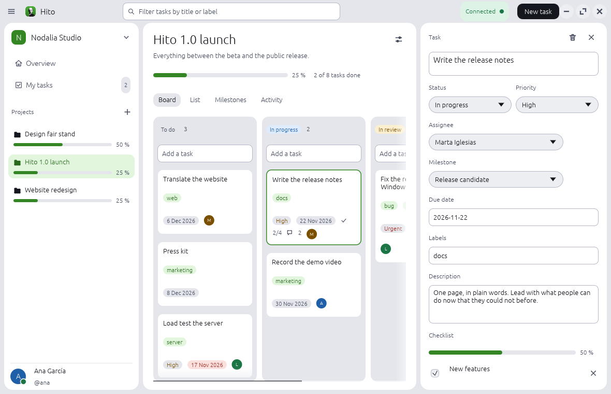
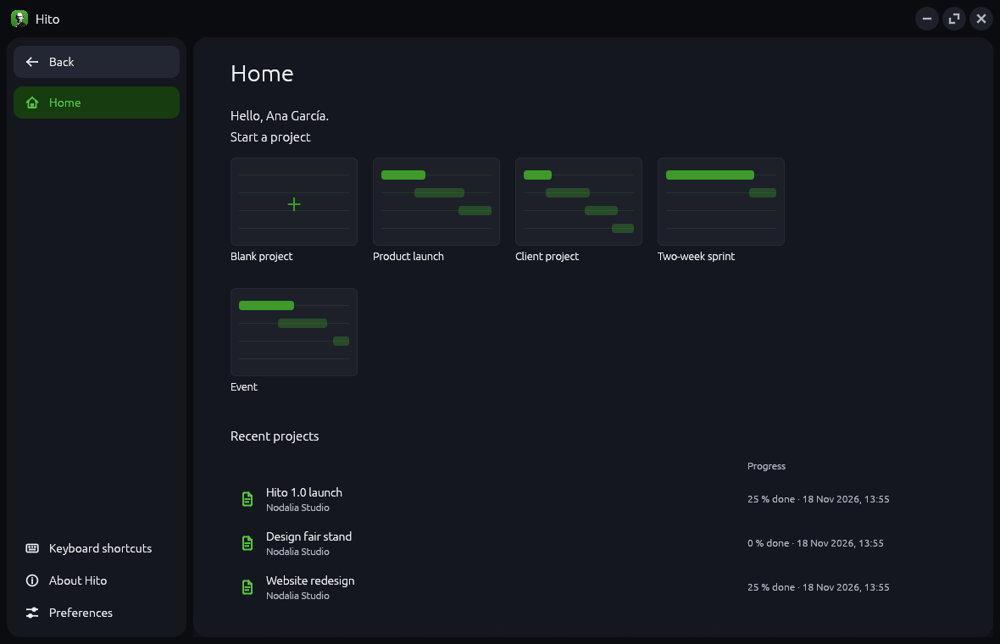
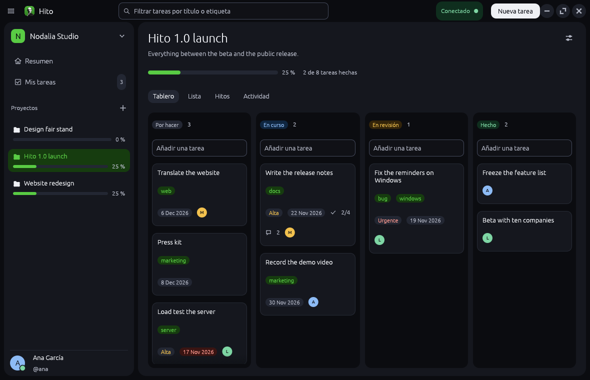

<div align="center">
  <a href="https://getnodalia.com">
    
  </a>
  <br><br>
  
  <h1>Hito</h1>
  <p><strong>Tasks, milestones and progress for your company, on a server you run yourself.</strong></p>

  <p>
    <a href="https://github.com/getnodalia/hito/releases/latest"></a>
    
    
    
    
  </p>

  <p>
    <a href="https://getnodalia.com/hito">Website</a> ·
    <a href="#screenshots">Screenshots</a> ·
    <a href="#features">Features</a> ·
    <a href="#download">Download</a> ·
    <a href="#build-it">Build</a> ·
    <a href="#security">Security</a> ·
    <a href="#license-and-credits">License</a>
  </p>
</div>

<p align="center">
  
  <br><sub>A project's board: what is to do, in progress, in review and done, and who has it.</sub>
</p>

---

## Overview

**Hito** is the work-tracking app of [Nodalia](https://getnodalia.com): projects with milestones,
tasks with assignees, priorities, due dates, labels, checklists and comments, a board, a list, an
activity log and an overview of how far every project has come. It runs on a server you run
yourself: one Rust binary with a SQLite file, no outside service. The desktop app is native
(egui, no Electron, no Chromium, no web view) for Linux, macOS and Windows, and belongs to the
Enterprise suite of Nodalia Design, with Ágora.

What your team writes is **end-to-end encrypted** with MLS (RFC 9420): task titles, descriptions,
checklists, labels, comments and milestone names reach the server only as ciphertext.

Hito works with [Ágora](https://github.com/getnodalia/agora), Nodalia's team chat: a webhook
posts a project's changes to an Ágora channel, and an API token lets other apps read and update
tasks as you.

> [!IMPORTANT]
> **Hito is at an early stage (0.1).** Everything under [Features](#features) is implemented and
> tested against a real server, but the protocol may still change before 1.0. The server still
> sees project names, statuses, dates, who is assigned and the activity log;
> [docs/security.md](docs/security.md) says exactly what the encryption protects and what it does
> not. Use TLS for any server outside your own computer.

## Screenshots

<table>
  <tr>
    <td width="50%"></td>
    <td width="50%"></td>
  </tr>
  <tr>
    <td><sub><b>Overview</b>: your open and overdue tasks, every project's progress and what is due soon.</sub></td>
    <td><sub><b>A task</b>: every field in one panel, its checklist and the team's comments.</sub></td>
  </tr>
  <tr>
    <td></td>
    <td></td>
  </tr>
  <tr>
    <td><sub><b>Milestones</b>: each with its date and its progress; a milestone is reached when its last task is done.</sub></td>
    <td><sub><b>Light theme</b>, chosen in Preferences, like the language.</sub></td>
  </tr>
  <tr>
    <td></td>
    <td></td>
  </tr>
  <tr>
    <td><sub><b>Home</b>: start a project from a template or open a recent one.</sub></td>
    <td><sub><b>In Spanish</b>: every screen is translated.</sub></td>
  </tr>
</table>

## Features

- **Accounts**: registration (open, by invitation or closed), sign-in, sign-out, sessions that
  expire, "stay signed in" on the desktop.
- **Workspaces** for a company or a team: invitations with codes that expire, roles (owner,
  admin, member, guest). Guests see only the projects they are added to. Workspaces are isolated
  from each other.
- **Projects** with a description, archived projects are read-only, and templates to start from
  (product launch, client project, two-week sprint, event).
- **Milestones** with a date and their progress; reaching one is recorded in the activity log.
- **Tasks** with a status (to do, in progress, in review, done), a priority, an assignee, a
  milestone, a due date, labels, a description and a checklist. Drag a card between columns or
  tick it off in the list.
- **Views**: board, list grouped by status, milestones, activity, **My tasks** across every
  project, and an **Overview** with open and overdue tasks and each project's progress.
- **Comments** on each task, encrypted like the rest.
- **Real time** over an authenticated WebSocket: what a teammate changes shows at once.
- **Integrations**: personal API tokens (`hito_pat_…`) for scripts and other apps, and webhooks
  that POST every change, signed with HMAC-SHA256, to an address such as an Ágora channel. A
  webhook carries only what the server already sees, never task text.
- **Desktop app**: Nodalia Design (Enterprise suite) with a Home page and dialogs for Preferences,
  shortcuts and About; light, dark and high-contrast themes, reduced motion, keyboard shortcuts, Spanish and
  English, the global menu over D-Bus on Linux, NDL window controls on Linux and native ones on
  macOS and Windows.

Not yet: file attachments, recurring tasks, time tracking, a Gantt timeline, notifications on
macOS and Windows, a web client, mobile apps. See [ROADMAP.md](ROADMAP.md).

## Download

Every release is on the [releases page](https://github.com/getnodalia/hito/releases/latest) and
on [getnodalia.com/hito](https://getnodalia.com/hito):

| System | Files |
|---|---|
| Linux, the app | `hito-<version>-linux-x86_64.AppImage`, `.deb`, `.rpm` or `.tar.gz` |
| Linux, the server | `hito-server-<version>-linux-x86_64.tar.gz` with `install.sh`, or the `hito-server` `.deb` and `.rpm`: the server alone, with its systemd service |
| macOS 11+, Apple Silicon and Intel | `hito-<version>-macos-universal.dmg` (the app), `hito-server-<version>-macos-universal.zip` |
| Windows 10/11 x64 | `hito-<version>-windows-x64.zip`: `hito.exe` and `hito-server.exe`, portable |

The macOS app is signed ad hoc, not with an Apple Developer ID: open it the first time with
right-click > Open. Windows SmartScreen warns the first time the files run ("More info" > "Run
anyway"). Checksums are in `SHA256SUMS`, `SHA256SUMS-macos` and `SHA256SUMS-windows`.

### A server on your own machine

On any Linux with systemd (a Debian or Ubuntu server, a Proxmox container, a small VPS):

```sh
curl -LO https://github.com/getnodalia/hito/releases/latest/download/hito-server-linux-x86_64.tar.gz
tar xzf hito-server-linux-x86_64.tar.gz && cd hito-server-*-linux-x86_64/
sudo ./install.sh
```

It installs the server as the `hito-server` service, listening on `127.0.0.1:7879`. Put a
reverse proxy with TLS in front of it and use its address in the app.
[docs/deployment.md](docs/deployment.md) covers the proxy, Proxmox, backups and upgrades.

## Build it

You need Rust 1.91 or newer. On Linux the desktop app also needs the usual windowing libraries
(Debian/Ubuntu: `sudo apt install libxkbcommon-dev libwayland-dev libgl1-mesa-dev libx11-dev libfontconfig1-dev`).

```sh
# The server, on http://127.0.0.1:7879 with ./hito.db
cargo run --release -p hito-server

# The desktop app (in another terminal)
cargo run --release -p hito-desktop
```

On a fresh server, run `cargo run --release -p hito-server -- init-token` using the same
configuration and database as the running server. Enter the one-use token in the invitation
code field when creating the first account. It expires after 15 minutes. On the sign-in screen,
the server is `localhost:7879`. The account owns the workspaces it creates. Copy
[`hito.example.toml`](hito.example.toml) to set the address, the database, who may register and
the limits, and start the server with `hito-server --config hito.toml`.

### A demo company

`examples/demo.rs` fills a fresh server with three people (Ana, Luis and Marta), a workspace and
three projects with milestones, tasks, checklists and comments, all encrypted like real ones. The
screenshots above come from it.

```sh
cargo run -p hito-server &                    # a fresh database
cargo run -p hito-server -- init-token         # prints the setup token
HITO_INIT_TOKEN=<token> HITO_DESKTOP_DIR=/tmp/hito-demo cargo run -p hito-desktop --example demo
HITO_DESKTOP_DIR=/tmp/hito-demo cargo run -p hito-desktop   # opens signed in as Ana
```

Each desktop client keeps its settings and session in the folder `HITO_DESKTOP_DIR` names, so
several can run side by side on one computer. The demo accounts' password is `demo-password-1`;
use it only on a demo server.

## Repository

| Path | What |
|---|---|
| `crates/hito-core` | Ids, roles and permissions, statuses, priorities, progress, limits, validation |
| `crates/hito-protocol` | The HTTP and WebSocket contract (versioned under `/api/v1`) |
| `crates/hito-storage` | SQLite storage with migrations (SQLx) |
| `crates/hito-e2e` | End-to-end encryption: a device, its MLS groups and what it decrypted |
| `crates/hito-client` | The client library: HTTP calls, the real-time connection and `Secure` (encrypt, sync, decrypt) |
| `apps/hito-server` | The server (Tokio, Axum) |
| `apps/hito-desktop` | The desktop app (egui, nodalia-theme) |
| `docs/` | [Architecture](docs/architecture.md), [protocol](docs/protocol.md), [security](docs/security.md), [deployment](docs/deployment.md) |

```sh
cargo test --workspace          # unit tests and the end-to-end server tests
cargo clippy --workspace --all-targets -- -D warnings
```

## Security

Passwords are hashed with Argon2id, sessions are random tokens stored only as hashes, every
request and the WebSocket are authenticated, workspaces, projects and guests are checked on every
read and write, inputs are validated and size- and rate-limited, and queries are parameterised.
The server refuses to listen on a public address without TLS in front of it unless you say so.
[docs/security.md](docs/security.md) has the whole model and its limits, and
[SECURITY.md](SECURITY.md) how to report a vulnerability.

## Contributing

Issues and pull requests are welcome. New contributors and AI agents start with
[`AGENTS.md`](AGENTS.md), then [`docs/`](docs/); what is planned is in [ROADMAP.md](ROADMAP.md),
and what is still moving to Nodalia Design is in [`NODALIA_MIGRATION.md`](NODALIA_MIGRATION.md).
`main` changes only through pull requests, which pass formatting, Clippy and the whole test suite.

## App icon

Lillian Moller Gilbreth, the engineer who studied how work is done and planned so that people could
do it better. The portrait comes from a Smithsonian Institution photograph with no known
restrictions, cut out in black and white on Hito's
green like every Nodalia app icon. Sources, sizes and licence are in
[ATTRIBUTION.md](ATTRIBUTION.md).

## The Nodalia suite

Hito is one of the applications of [Nodalia](https://getnodalia.com)
([GitHub](https://github.com/getnodalia)), an independent software project developed in public
by [Daniel Miguel Tejedor](https://danielmigueltejedor.com). It shares the Nodalia Design
Language from [nodalia-design](https://github.com/getnodalia/nodalia-design) and Nodalia's
engineering rules from [getnodalia/foundation](https://github.com/getnodalia/foundation).

## License and credits

Hito is dual-licensed under [MIT](LICENSE-MIT) or [Apache-2.0](LICENSE-APACHE), at your option.
Every asset keeps its own open licence and is listed with its author, source and licence in
[ATTRIBUTION.md](ATTRIBUTION.md).
